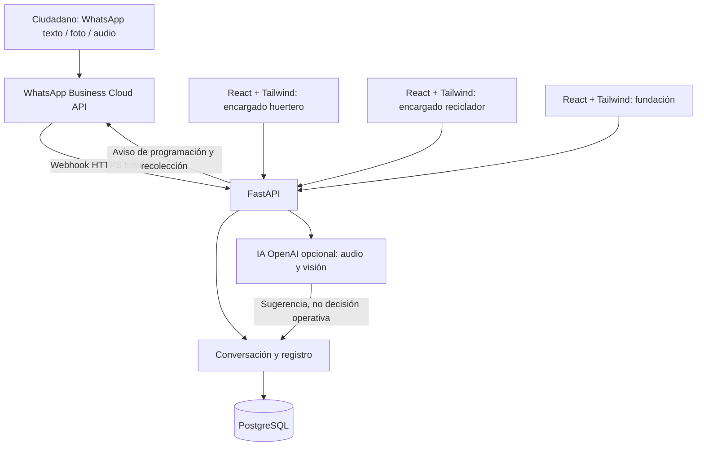

# Arquitectura — EcoConecta MVP

## Roles y alcance

- `coordinador_huerta`: revisar, asignar y programar **orgánicos**.
- `huertero`: cerrar solamente tareas orgánicas que tenga asignadas.
- `coordinador_reciclaje`: revisar, asignar y programar **reciclables**.
- `reciclador`: cerrar solamente tareas reciclables que tenga asignadas.
- `administrador`: panel de informes, ciudadanía piloto y regla de puntos.
- La regla de puntos del piloto se configura como puntos por kg. Solo al confirmar una recolección en kg se calcula el puntaje proporcional; las fracciones se redondean hacia abajo a puntos enteros.

Durante el piloto una persona puede tener 2 roles (ej.: `coordinador_huerta` y `huertero`); **cada evento guarda el actor y la acción**. No se autoprograman las recolecciones.

## Modelo de datos PostgreSQL

- `usuarios_internos` → `usuarios_roles`, `sesiones`.
- `ciudadanos` → `solicitudes` (1:N).
- `solicitudes` → `historial_solicitudes` (1:N).
- `solicitudes` → `movimientos_puntos` (1:0..1).
- `reglas_puntos` → `movimientos_puntos` (1:N).
- `whatsapp_eventos` conserva IDs externos para idempotencia.
- `conversaciones_whatsapp` conserva el paso de la conversación por número.

## Seguridad esencial

Credenciales solo en `.env`, acceso a datos según roles, validación HMAC de webhooks, personas visibles únicamente a equipo responsable, consentimientos y consulta por teléfono del propio ciudadano. Los mensajes de IA se procesan sin enviar datos personales innecesarios; pruebas con datos ficticios.

## Pendientes para producción

HTTPS y dominio público, proveedor y ubicación de nube autorizados por el organizador, copias de seguridad, migraciones versionadas, almacenamiento privado durable de fotos, salida WhatsApp de notas de voz, políticas de retención, límite de intentos de inicio de sesión, colas/reintentos e idempotencia transaccional más robusta ante webhooks concurrentes.
