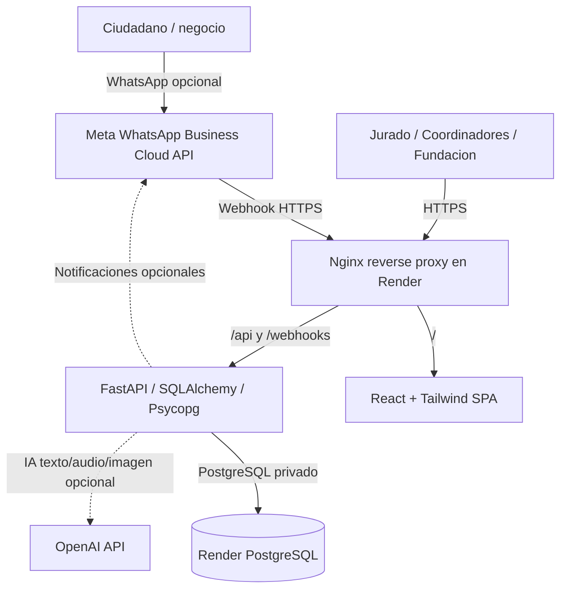
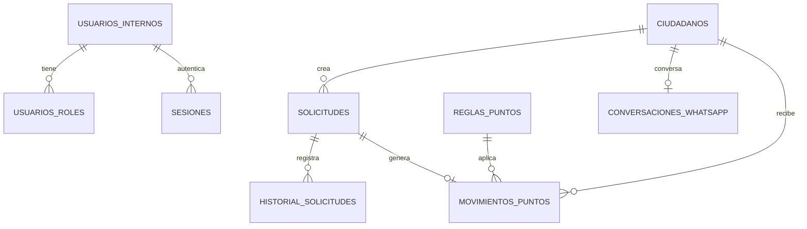

# Arquitectura de entrega — EcoConecta

## Componentes

El contenedor Render sirve React y API en un dominio compartido; PostgreSQL es un servicio aparte. No almacenar secretos en GitHub. La programación final, la asignación y el cierre se hacen mediante humanos autenticados.

## Modelo de datos resumido

## Restricciones del reto
- RN-01: separación estricta orgánicos / reciclables.
- RN-02: programación con fecha/hora futura y persona asignada.
- RN-03: coordinador y recolector registrados.
- RN-04: id, estado e historial.
- RN-05: puntos solo después de recolección.
- RN-06: regla parametrizable, valores no oficiales FSD.
- RN-07: perfiles con autorización y datos personales mínimos.
- RN-08: habilitación explícita del piloto.

## Componentes cloud para declarar en entrega
- Proveedor: **Render** (solo si realmente se desplegó allí).
- Compute: Render Docker web service; Nginx, React estático, Python 3.12 / FastAPI.
- Datos: Render PostgreSQL administrado.
- Red: dominio HTTPS Render + red entre servicio y PostgreSQL.
- Externos opcionales: Meta Cloud API y OpenAI (si se configuraron y probaron).
- Almacenamiento adicional: no usado en la demo, salvo que otro compañero implemente almacenamiento de medios.
